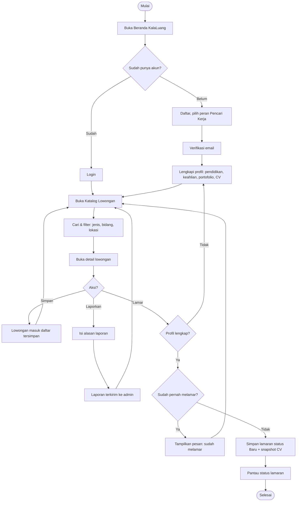
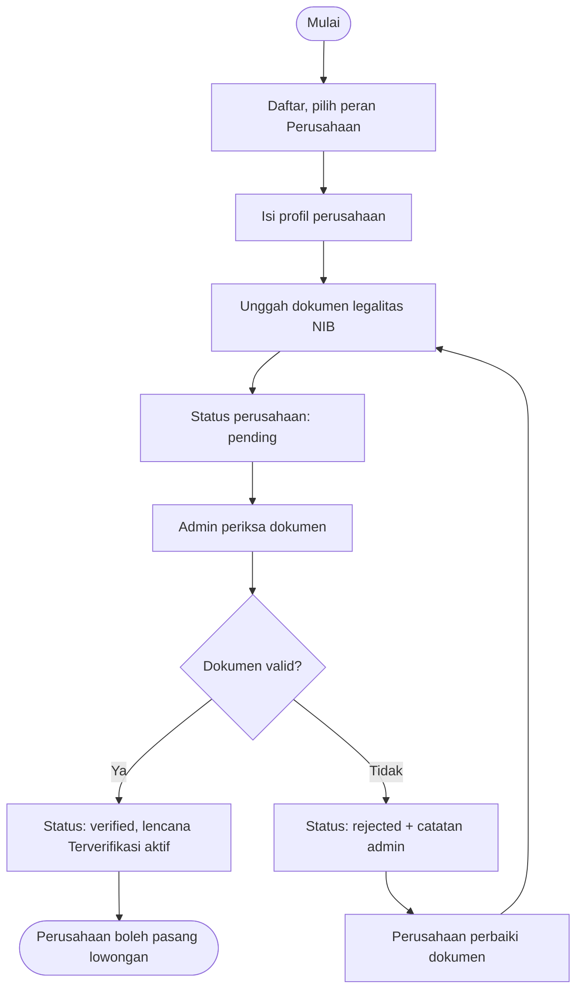
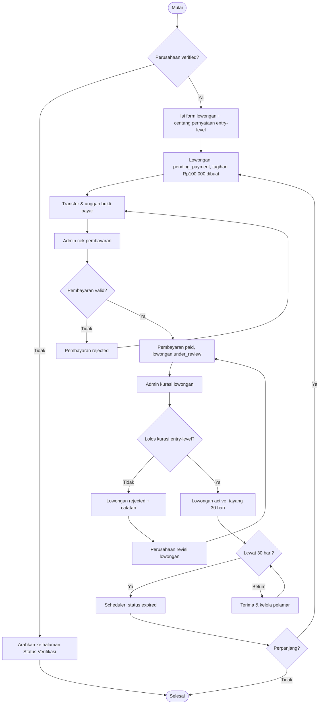
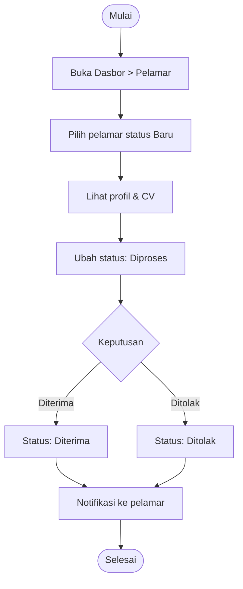
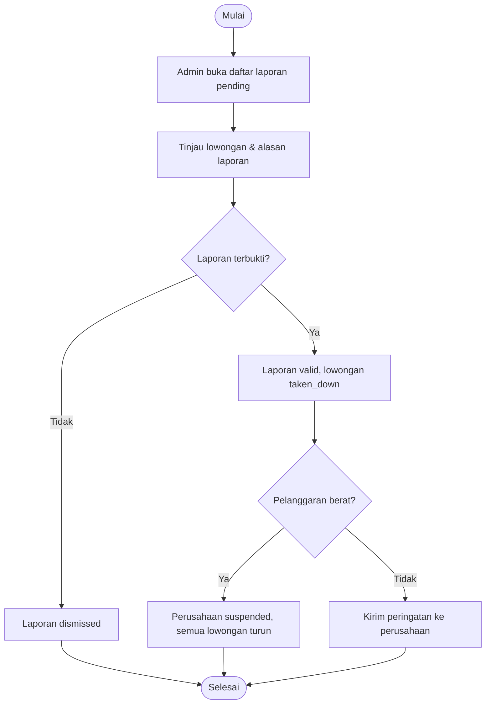

# Flowchart — KalaLuang

Diagram ditulis dengan sintaks [Mermaid](https://mermaid.js.org/).

## 1. Alur Utama Pencari Kerja

## 2. Alur Registrasi & Verifikasi Perusahaan

## 3. Alur Pasang Lowongan, Pembayaran & Kurasi

## 4. Alur Kelola Pelamar (Perusahaan)

## 5. Alur Penanganan Laporan (Admin)

