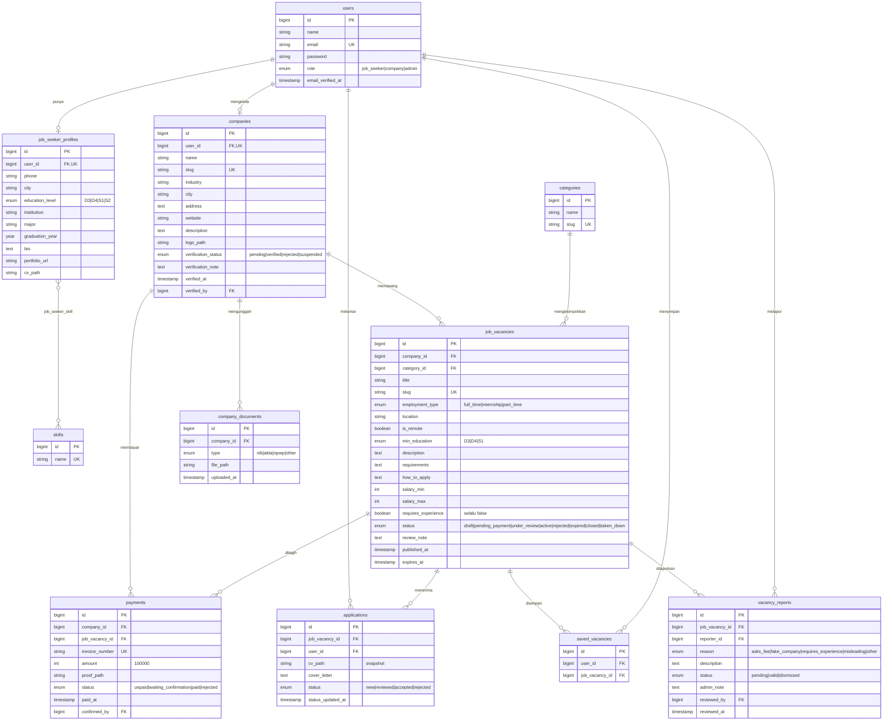

# ERD — KalaLuang

## 1. Diagram (Mermaid)

## 2. Kamus Data

### `users`
| Kolom | Tipe | Keterangan |
|---|---|---|
| `id` | bigint, PK | |
| `name` | string | Nama pengguna |
| `email` | string, unique | Dipakai untuk login |
| `email_verified_at` | timestamp, nullable | Verifikasi email Laravel |
| `password` | string, hashed | |
| `role` | enum `UserRole` | `job_seeker` / `company` / `admin`. Default `job_seeker` |
| `remember_token` | string, nullable | |

### `job_seeker_profiles`
| Kolom | Tipe | Keterangan |
|---|---|---|
| `user_id` | FK → users, unique | `cascadeOnDelete` |
| `phone` | string, nullable | No. HP |
| `city` | string, nullable | Kota domisili |
| `education_level` | enum `EducationLevel`, nullable | `D3` / `D4` / `S1` / `S2` |
| `institution` | string, nullable | Nama kampus |
| `major` | string, nullable | Jurusan |
| `graduation_year` | smallint unsigned, nullable | Tahun lulus |
| `bio` | text, nullable | |
| `portfolio_url` | string, nullable | Link portofolio |
| `cv_path` | string, nullable | Path file CV (PDF, maks 2 MB) |

### `skills` & `job_seeker_skill`
| Kolom | Tipe | Keterangan |
|---|---|---|
| `skills.name` | string, unique | Nama keahlian |
| `job_seeker_skill` | pivot | (`job_seeker_profile_id`, `skill_id`), primary key gabungan |

### `companies`
| Kolom | Tipe | Keterangan |
|---|---|---|
| `user_id` | FK → users, unique | `cascadeOnDelete` |
| `name` | string | Nama perusahaan |
| `slug` | string, unique | |
| `industry` | string | Bidang industri |
| `city` | string | |
| `address` | text, nullable | |
| `website` | string, nullable | Situs / medsos |
| `description` | text, nullable | |
| `logo_path` | string, nullable | |
| `verification_status` | enum `CompanyVerificationStatus` | `pending` / `verified` / `rejected` / `suspended`. Default `pending` |
| `verification_note` | text, nullable | Catatan alasan admin |
| `verified_at` | timestamp, nullable | |
| `verified_by` | FK → users (admin), nullable | `nullOnDelete` |
| `deleted_at` | timestamp, nullable | `softDeletes` |

### `company_documents`
| Kolom | Tipe | Keterangan |
|---|---|---|
| `company_id` | FK → companies | `cascadeOnDelete` |
| `type` | enum `DocumentType` | `nib` (wajib) / `akta` / `npwp` / `other` |
| `file_path` | string | |
| `uploaded_at` | timestamp | |

### `categories`
| Kolom | Tipe | Keterangan |
|---|---|---|
| `name` | string | Nama bidang |
| `slug` | string, unique | |

### `job_vacancies`
| Kolom | Tipe | Keterangan |
|---|---|---|
| `company_id` | FK → companies | `cascadeOnDelete` |
| `category_id` | FK → categories | `restrictOnDelete` |
| `title` | string | Judul lowongan |
| `slug` | string, unique | |
| `employment_type` | enum `EmploymentType` | `full_time` / `internship` / `part_time` |
| `location` | string, nullable | Kosong jika remote |
| `is_remote` | boolean | Default `false` |
| `min_education` | enum `EducationLevel` | `D3` / `D4` / `S1` |
| `description` | text | |
| `requirements` | text | |
| `how_to_apply` | text | |
| `salary_min` / `salary_max` | int unsigned, nullable | Rentang gaji (opsional) |
| `requires_experience` | boolean | **Selalu `false`** (BR-04) |
| `status` | enum `VacancyStatus` | `draft` / `pending_payment` / `under_review` / `active` / `rejected` / `expired` / `closed` / `taken_down`. Default `draft` |
| `review_note` | text, nullable | Catatan kurasi admin |
| `published_at` | timestamp, nullable | Diisi saat lolos kurasi |
| `expires_at` | timestamp, nullable | `published_at + 30 hari` |
| `deleted_at` | timestamp, nullable | `softDeletes` |

### `payments`
| Kolom | Tipe | Keterangan |
|---|---|---|
| `company_id` | FK → companies | `cascadeOnDelete` |
| `job_vacancy_id` | FK → job_vacancies | `cascadeOnDelete` |
| `invoice_number` | string, unique | |
| `amount` | int unsigned | Dari `config('kalaluang.listing_price')` = 100000 |
| `proof_path` | string, nullable | Bukti transfer |
| `status` | enum `PaymentStatus` | `unpaid` / `waiting_confirmation` / `paid` / `rejected`. Default `unpaid` |
| `paid_at` | timestamp, nullable | |
| `confirmed_by` | FK → users (admin), nullable | `nullOnDelete` |

### `applications`
| Kolom | Tipe | Keterangan |
|---|---|---|
| `job_vacancy_id` | FK → job_vacancies | `cascadeOnDelete` |
| `user_id` | FK → users | `cascadeOnDelete` |
| `cv_path` | string | Snapshot CV saat melamar |
| `cover_letter` | text, nullable | |
| `status` | enum `ApplicationStatus` | `new` / `reviewed` / `accepted` / `rejected`. Default `new` |
| `status_updated_at` | timestamp, nullable | |
| — | unique | (`job_vacancy_id`, `user_id`) — BR-05 |

### `saved_vacancies`
| Kolom | Tipe | Keterangan |
|---|---|---|
| `user_id` | FK → users | `cascadeOnDelete` |
| `job_vacancy_id` | FK → job_vacancies | `cascadeOnDelete` |
| — | unique | (`user_id`, `job_vacancy_id`) |

### `vacancy_reports`
| Kolom | Tipe | Keterangan |
|---|---|---|
| `job_vacancy_id` | FK → job_vacancies | `cascadeOnDelete` |
| `reporter_id` | FK → users | `cascadeOnDelete` |
| `reason` | enum `ReportReason` | `asks_fee` / `fake_company` / `requires_experience` / `misleading` / `other` |
| `description` | text, nullable | Keterangan pelapor |
| `status` | enum `ReportStatus` | `pending` / `valid` / `dismissed`. Default `pending` |
| `admin_note` | text, nullable | |
| `reviewed_by` | FK → users (admin), nullable | `nullOnDelete` |
| `reviewed_at` | timestamp, nullable | |
| — | unique | (`job_vacancy_id`, `reporter_id`) — BR-08 |

## 3. Constraint & Catatan Penting

- Semua tabel punya `created_at`, `updated_at`. `job_vacancies` dan `companies` pakai `softDeletes`.
- `users.role` → Enum `UserRole`. Admin dibuat lewat seeder saja (tidak bisa daftar sendiri).
- `companies.verified_by`, `payments.confirmed_by`, `vacancy_reports.reviewed_by` → FK ke `users.id` (admin), `nullOnDelete`.
- Index: `job_vacancies(status, expires_at)`, `job_vacancies(category_id)`, `job_vacancies(employment_type)`, `job_vacancies(location)`.
- Harga lowongan disimpan di `config/kalaluang.php` (`listing_price => 100000`, `listing_duration_days => 30`), jangan hardcode.
- Model `JobVacancy` punya scope `published()` = status `active` + `expires_at > now()` + `whereHas company verified`. Scope ini yang dipakai katalog (BR-03).
- `JobSeekerProfile::isComplete()` → `true` jika `education_level`, `institution`, `major`, `cv_path` terisi (BR-06).

## 4. Enum (`app/Enums/`)

Setiap enum punya method `label(): string` yang mengembalikan label bahasa Indonesia.

| Enum | Case → Label |
|---|---|
| `UserRole` | `JobSeeker` → Pencari Kerja · `Company` → Perusahaan · `Admin` → Admin |
| `CompanyVerificationStatus` | `Pending` → Menunggu Verifikasi · `Verified` → Terverifikasi · `Rejected` → Ditolak · `Suspended` → Ditangguhkan |
| `DocumentType` | `Nib` → NIB · `Akta` → Akta Pendirian · `Npwp` → NPWP · `Other` → Dokumen Lain |
| `EmploymentType` | `FullTime` → Penuh waktu · `Internship` → Magang · `PartTime` → Paruh waktu |
| `EducationLevel` | `D3` → D3 · `D4` → D4 · `S1` → S1 · `S2` → S2 |
| `VacancyStatus` | `Draft` → Draf · `PendingPayment` → Menunggu Pembayaran · `UnderReview` → Sedang Ditinjau · `Active` → Tayang · `Rejected` → Ditolak · `Expired` → Kedaluwarsa · `Closed` → Ditutup · `TakenDown` → Diturunkan |
| `PaymentStatus` | `Unpaid` → Belum Dibayar · `WaitingConfirmation` → Menunggu Konfirmasi · `Paid` → Lunas · `Rejected` → Ditolak |
| `ApplicationStatus` | `New` → Baru · `Reviewed` → Diproses · `Accepted` → Diterima · `Rejected` → Ditolak |
| `ReportReason` | `AsksFee` → Meminta biaya · `FakeCompany` → Perusahaan fiktif · `RequiresExperience` → Mensyaratkan pengalaman · `Misleading` → Informasi menyesatkan · `Other` → Lainnya |
| `ReportStatus` | `Pending` → Menunggu Tinjauan · `Valid` → Terbukti · `Dismissed` → Tidak Terbukti |
